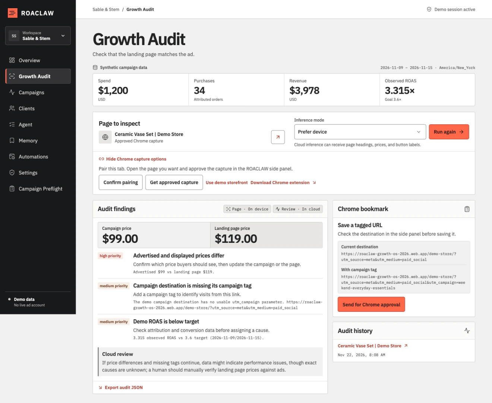
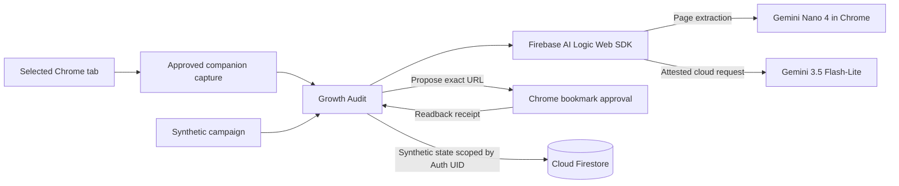

# ROACLAW

An ad offers a vase set for **$99**. Its landing page shows **$119**. ROACLAW compares the ad with the page, shows the evidence behind each finding, and lets you approve the exact tracked bookmark in Chrome.

[Try Growth Audit](https://roaclaw-growth-os-2026.web.app/app/) · [Check your own landing page](https://roaclaw-growth-os-2026.web.app/app/preflight/) · [Download the Chrome companion](https://roaclaw-growth-os-2026.web.app/roaclaw-extension.zip) · [Judge walkthrough](submission/JUDGE_GUIDE.md)

[](docs/screenshots/README.md)

Built for **#BuildHybridAI 2026 · Web (Chrome)**. The public demo uses fictional campaigns and creates an anonymous workspace. Open the [screenshot gallery](docs/screenshots/README.md) for Campaign Preflight, the Chrome side panel, and the product site.

## Try the two workflows

| Workflow | What to do | What to look for |
|---|---|---|
| Growth Audit | Open the ecommerce demo and run **Prefer device**. Then attach a Chrome capture and send the proposed link for review. | The $99 and $119 prices, missing campaign tag, actual inference sources, and the bookmark receipt after approval. |
| Campaign Preflight | Enter an offer, destination and expected button. Pair Chrome, capture a public page, attach it and run the comparison. | Matches and mismatches with page evidence, explicit review for ambiguous prices, a tracked destination, and an HTML report. |

[Step-by-step walkthrough](submission/JUDGE_GUIDE.md) · [Product website](https://roaclaw-growth-os-2026.web.app/) · [Verification evidence](qa/EVIDENCE_INDEX.md) · [Versioned releases](https://github.com/AmirmLotfy/roaclaw-growth-os/releases)

## Where Firebase runs



- **Inference.** The web app calls Firebase AI Logic for structured page extraction. Prefer device uses Nano when it is ready and can fall back to Gemini 3.5 Flash-Lite for synthetic demo evidence. A separate Firebase call reviews the findings in the cloud. Growth Audit shows the sources reported by the SDK. [Runtime code](apps/web/lib/inference.ts)
- **Data.** Firebase Authentication starts anonymous sessions. User-scoped Firestore rules isolate the synthetic workspaces. External Growth Audit captures use device-only inspection. Preflight keeps the brief and comparison in the current tab and offers optional device-only inspection. [Firestore rules](firestore.rules) · [Tenancy checks](qa/backend/README.md)
- **Chrome.** The Manifest V3 companion binds explicit pairing to an approved origin, tab and session. The user initiates capture on the selected tab. Chrome writes a bookmark after review and approval and sends back a verified receipt. [Chrome setup and permissions](apps/extension/README.md)
- **Hosting.** Next.js exports the website, dashboard, fixture storefronts and unpacked-extension ZIP through Firebase Hosting. [Build configuration](firebase.json)

## Build and test from source

Use Node.js 22, pnpm 10.34.9, and the `zip` command. Chrome Desktop is required for browser and on-device verification.

```sh
npm exec --yes --package=pnpm@10.34.9 -- pnpm install --frozen-lockfile
npm exec --yes --package=pnpm@10.34.9 -- pnpm check
npm exec --yes --package=pnpm@10.34.9 -- pnpm test
node --test apps/extension/tests/*.test.js
```

For a working local Firebase environment, copy [`.env.example`](apps/web/.env.example) to `apps/web/.env.local` and fill in the public client configuration for your own Firebase Web app. Enable anonymous Auth, provision Firestore and apply `firestore.rules`, and enable Firebase AI Logic with the Gemini Developer API. Register reCAPTCHA Enterprise for the deployed web origin. Use an App Check debug token only in an authorized loopback test, and keep it out of source control. [Backend setup and emulator tests](qa/backend/README.md) · [Independent hybrid probe](tools/hybrid-proof/README.md)

```sh
npm exec --yes --package=pnpm@10.34.9 -- pnpm dev
npm exec --yes --package=pnpm@10.34.9 -- pnpm build
```

The development app opens at `http://127.0.0.1:3000/app/`. The build writes `apps/web/out/` and packages the companion as `apps/web/public/roaclaw-extension.zip`. CI also compiles the static export from a clean checkout using placeholder client settings. [Project checks](https://github.com/AmirmLotfy/roaclaw-growth-os/actions/workflows/check.yml) · [CI configuration](.github/workflows/check.yml)

## Current limits

| Area | Behavior |
|---|---|
| Campaign data | The dashboard uses fictional workspaces and campaigns. Account connectors and team approvals are outside this release. |
| Offline | An already open demo tab with Gemini Nano 4 ready can audit on-device, export the result, and sync after reconnecting. |
| Cloud review | Public demo requests require App Check. An attestation denial can leave a completed device-only audit in a model-ready Chrome profile. [Live evidence](qa/EVIDENCE_INDEX.md#app-check-repair-and-full-growth-audit-rerun) |
| Preflight tracking | The report checks URL parameters and visible evidence. Analytics delivery and attribution require separate verification. |
| Follow-ups and voice | Due price checks run on request from the dashboard. The Agent offers text lookup. The Firebase Web Live transport failed its App Check test. [Voice evidence](qa/backend/live-voice.md) |

## License and credits

ROACLAW Growth OS was built as an independent project starting 22 November 2026. The code and ROACLAW-created project assets are available under [Apache License 2.0](LICENSE). Fonts, icons, and other third-party materials retain their own terms. [Asset and dependency notices](THIRD_PARTY_NOTICES.md) · [Changelog](CHANGELOG.md)
