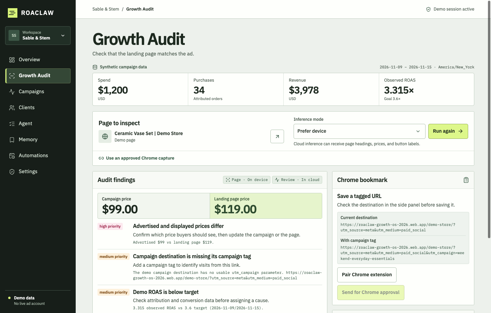
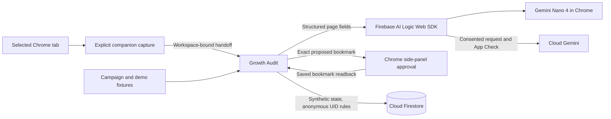

# ROACLAW Growth Audit

An ad offers a vase set for **$99**. Its landing page shows **$119**. ROACLAW brings the two sources into one audit, checks the tracking tag, and lets you approve the exact bookmark in Chrome.

[Product website](https://roaclaw-growth-os-2026.web.app/) · [Open Growth Audit](https://roaclaw-growth-os-2026.web.app/app/) · [Download the Chrome companion](https://roaclaw-growth-os-2026.web.app/roaclaw-extension.zip) · [Test evidence](qa/EVIDENCE_INDEX.md)



## Try it in Chrome

1. Open Growth Audit, choose **Open demo**, and select the **Ecommerce** workspace. Firebase Auth creates a private anonymous demo session. Use **Lead generation** or **Agency** for the other two demo scenarios.
2. Select **Prefer device** and run the audit. Compatible Chrome reads the page with Gemini Nano 4 and Firebase AI Logic runs a separate cloud review. A profile without Nano may use the cloud for the page as well. Read **Page** and **Review** for their actual SDK sources.
3. Select **Device only** to test local extraction. In Chrome Desktop, enable **Gemma 4 for Built-in AI** where required and wait for the model to be ready at `chrome://on-device-internals`. Google documents a 22 GB free-space requirement for an initial download. Keep the open demo tab for the offline rerun. [Chrome requirements](https://developer.chrome.com/docs/ai/get-started) · [Firebase Web setup](https://firebase.google.com/docs/ai-logic/hybrid/web/get-started)
4. Extract the released ZIP. Open `chrome://extensions`, enable **Developer mode**, and choose **Load unpacked**. From Growth Audit, click **Use an approved Chrome capture**, request pairing, and confirm the workspace in the Chrome panel. Open the demo storefront and click the extension toolbar icon there before capturing.
5. Back in the dashboard, attach the capture and run the audit. Send the tagged URL for Chrome approval. Select **Review save** and **Save to Chrome**, then **Check receipt** in the dashboard. Memory lists the verified receipt. Chrome grants bookmark and recent-history permissions only when requested.
6. In **Automations**, schedule the price recheck for one minute, wait until due, and select **Run due checks**. The app fetches the latest price from the live demo storefront. Due checks run on request.

## Architecture



- **Inference.** [`apps/web/lib/inference.ts`](apps/web/lib/inference.ts) calls the hybrid SDK and validates extraction against visible evidence. Separate cloud reasoning receives sourced findings. Page snapshots outside the demo stay in the current tab and use device-only analysis.
- **Identity.** Firebase Authentication and Firestore rules scope synthetic records to each demo UID. Workspace edits merge through Firestore transactions. The demo does not require an advertiser login.
- **Browser.** The Manifest V3 companion accepts short-lived, origin-checked and tab-bound pairing. Capture requires the active tab. A proposed URL does not create a bookmark until the user approves it in Chrome, and the dashboard records the receipt returned after readback.
- **Deployment.** Next.js static export provides the product site, dashboard, demo storefronts, and extension ZIP through Firebase Hosting.

## Run from source

Use Node 22, pnpm 10.34.9, Google Chrome Desktop, and the Unix `zip` command.

```sh
npm exec --yes --package=pnpm@10.34.9 -- pnpm install --frozen-lockfile
npm exec --yes --package=pnpm@10.34.9 -- pnpm check
npm exec --yes --package=pnpm@10.34.9 -- pnpm test
node --test apps/extension/tests/*.test.js
```

Copy [`.env.example`](apps/web/.env.example) to `apps/web/.env.local` and use your Firebase Web app configuration. Enable anonymous Auth, provision Firestore, apply [the rules](firestore.rules), and configure Firebase AI Logic with the Gemini Developer API backend. Register reCAPTCHA Enterprise for the production origin. Use only a local App Check debug setup for loopback cloud testing. [Backend verification](qa/backend/README.md) · [Hybrid proof setup](tools/hybrid-proof/README.md)

```sh
npm exec --yes --package=pnpm@10.34.9 -- pnpm dev
npm exec --yes --package=pnpm@10.34.9 -- pnpm build
```

Visit `http://127.0.0.1:3000/app/` for development. The build writes the static site to `apps/web/out/` and an installable companion ZIP to `apps/web/public/roaclaw-extension.zip`. [Extension setup and verification](apps/extension/README.md) · [Browser and accessibility evidence](qa/EVIDENCE_INDEX.md)

## Scope and limits

| Area | Current behavior |
|---|---|
| Campaigns and storefronts | Fictional demo records with sourced, repeatable calculations. Paid-media and ecommerce account connectors are outside this release. |
| Offline | Gemini Nano 4 can run on a supported Chrome profile with the model ready. An already open demo tab can run locally, export the result, and sync after reconnecting. |
| Chrome permissions | Page capture uses active-tab access. Bookmark and recent-history searches stay in Chrome. |
| Follow-ups | Scheduled records can be run or canceled in the workspace. Due checks run on request from the dashboard. |
| Voice | The app includes text lookup. The protected Firebase Live transport rejected the Web SDK connection with an App Check error. [Transport evidence](qa/evidence/live/transport.json) |

Built from scratch for #BuildHybridAI 2026, starting 22 November 2026. The synthetic storefront contains an original generated illustration. Design references informed the interface. The repository includes ROACLAW’s own source and captures under the [Apache 2.0 license](LICENSE). Dependencies retain their own licenses. [Asset and dependency notices](THIRD_PARTY_NOTICES.md)
