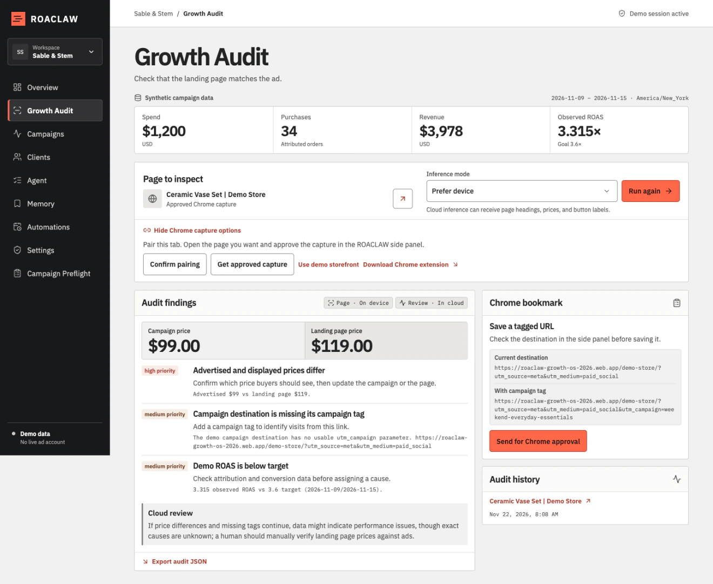
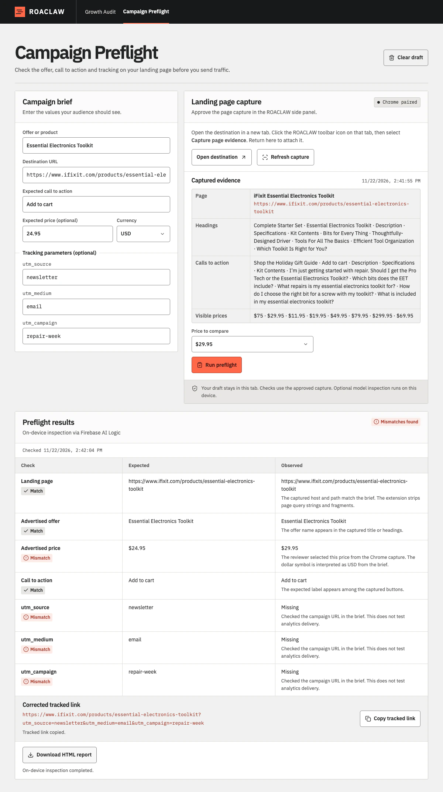
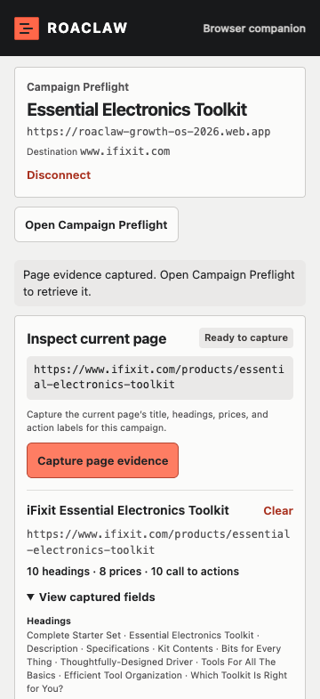
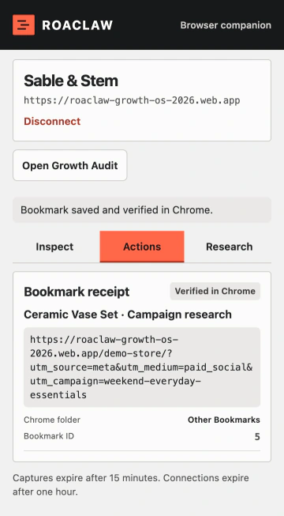
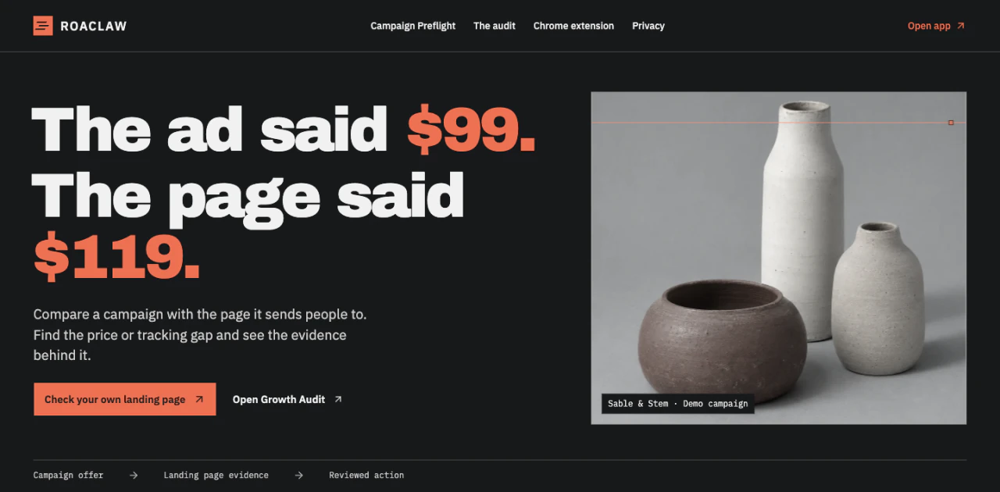

# ROACLAW screenshots

These screenshots come from the hosted 0.3.1 release candidate and Chrome companion runs on 22 November 2026. Open a screenshot to see it at full size. [Test evidence](../../qa/EVIDENCE_INDEX.md)

## Growth Audit

Growth Audit found a $119 price on the Sable & Stem demo storefront after a user approved the Chrome capture. The synthetic campaign advertised $99. Firebase AI Logic reported on-device page inspection and a separate cloud review. [Chrome companion run](../../qa/evidence/app-check-repair/companion.json) · [Original screenshot](../../qa/evidence/app-check-repair/companion-hybrid.png)

## Campaign Preflight

An operator-authored test brief expected $24.95 for the iFixit Essential Electronics Toolkit. The reviewer selected $29.95 from the captured page prices. Preflight flagged the mismatch, matched the “Add to cart” call to action, and offered a corrected tracking link and an HTML report. [Preflight run](../../qa/evidence/preflight-0.3.1.json)

## Chrome companion

The side panel captured evidence from the selected iFixit page for Preflight. In the separate Sable & Stem demo, Chrome saved a tagged bookmark after explicit approval and returned its folder and ID. [Preflight run](../../qa/evidence/preflight-0.3.1.json) · [Bookmark run](../../qa/evidence/app-check-repair/companion.json) · [Original receipt](../../qa/evidence/app-check-repair/companion-receipt.png)

| Preflight capture | Verified bookmark |
| --- | --- |
|  |  |

## Product website

The homepage introduces the Sable & Stem price discrepancy and links to Campaign Preflight and the Growth Audit demo. [Hosted website run](../../qa/evidence/app-check-repair/hosted.json)

